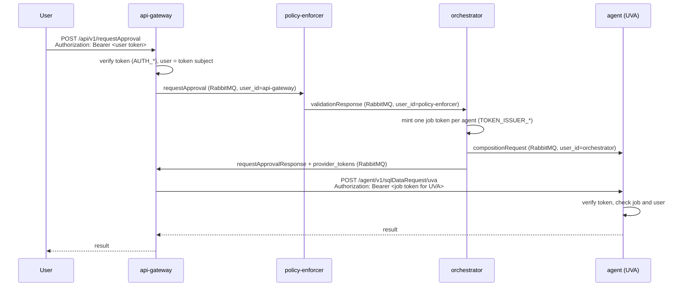
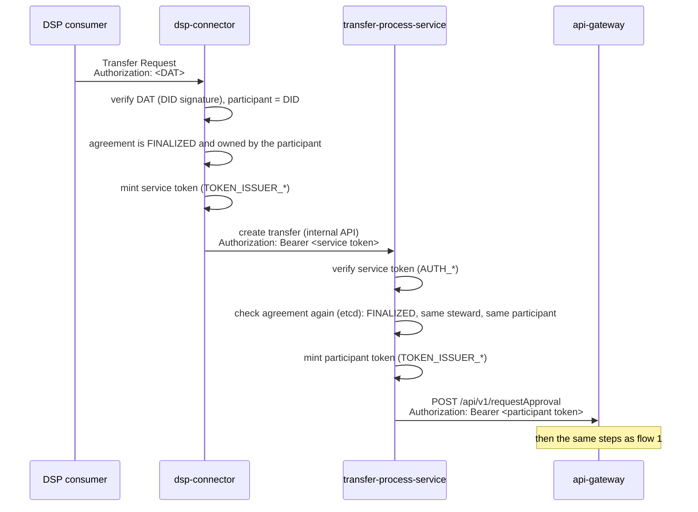

# Authentication flows

## 1. Data request from an end user

Steps:

1. The user sends the request with a bearer token. api-gateway verifies the token with its `AUTH_*` providers (for example `oidc`).
2. api-gateway takes the user from the token subject. It ignores the user name in the request body. The token subject must be the user name in the etcd agreements, because policy-enforcer matches on it.
3. policy-enforcer checks the agreements. The orchestrator makes the job.
4. The orchestrator mints one job token for each agent of the job (`go/cmd/orchestrator/job_tokens.go`):

   | Claim | Value |
   |-------|-------|
   | `iss` | `dynamos-orchestrator` |
   | `aud` | the agent (for example `UVA`) |
   | `sub` | the user |
   | `scope` | `agent:<requestType>` (for example `agent:sqlDataRequest`) |
   | `attrs.jobId` | the job ID |
   | `exp` | 5 minutes after issue |

   The tokens go to api-gateway in the field `provider_tokens` of `RequestApprovalResponse`.
5. api-gateway sends each agent its own token.
6. The agent verifies the token (signature, issuer, audience = its `DATA_STEWARD_NAME`, scope). Then it checks that the token subject is the user of the request and that `attrs.jobId` is the job of the request (`authorizeJob` in `go/cmd/agent/token_validation.go`). A token for one job or one agent does not work for another.

## 2. Data request from a DSP participant

dsp-connector mints a new service token for each call to the internal API of transfer-process-service or negotiation-service (`go/cmd/dsp-connector/internal_auth.go`). Each service gets its own audience and scope, so a token for one service does not work at the other:

| Claim | transfer-process-service | negotiation-service |
|-------|--------------------------|---------------------|
| `iss` | `dynamos-dsp-connector` | `dynamos-dsp-connector` |
| `aud` | `transfer-process-service` (`TRANSFER_SERVICE_AUDIENCE`) | `negotiation-service` (`NEGOTIATION_SERVICE_AUDIENCE`) |
| `sub` | `dsp-connector` | `dsp-connector` |
| `kind` | `service` | `service` |
| `scope` | `transfer-process-service:internal` | `negotiation-service:internal` |
| `exp` | 1 minute after issue | 1 minute after issue |

The internal APIs use one rule (`go/pkg/auth/internalapi`). `/health` does not need a token. Every other path needs a valid token with the scope of the service and an allowed kind. The service answers 401 without a valid token and 403 for a token of another kind or without the scope.

| Service | Allowed kinds | Callers |
|---------|---------------|---------|
| transfer-process-service | `service` | dsp-connector |
| negotiation-service | `service`, `user` | dsp-connector, operators |

A `participant` token never reaches an internal API, because these APIs trust their caller for the participant of a transfer or negotiation.

transfer-process-service mints this token (`go/cmd/transfer-process-service/gateway_auth.go`):

| Claim | Value |
|-------|-------|
| `iss` | `dynamos-transfer-process-service` |
| `aud` | `api-gateway` (`GATEWAY_TOKEN_AUDIENCE` changes it) |
| `sub` | the participant DID |
| `kind` | `participant` |
| `scope` | `gateway:requestApproval` |
| `exp` | 2 minutes after issue |

api-gateway accepts a token of kind `service` or `participant` only when it has the scope `gateway:requestApproval`.

### Operators on negotiation-service

On the Provider side, negotiation-service does not send the offer, the agreement or the `FINALIZED` event by itself. An operator sends them to the internal API (`/internal/v1/negotiations/{id}/offer`, `/agreement`, `/events`). `FINALIZED` also gives the participant access to data (the policy-enforcer relation), so these are admin actions.

- In Tilt, use `$DYNAMOS_OPERATOR_TOKEN`. The negotiation-service chart accepts it (`static-dev`, scope `negotiation-service:internal`).
- In production, add an identity provider to `AUTH_PROVIDERS` of negotiation-service (for example `oidc`), whose operator tokens have the scope `negotiation-service:internal`.
- The DSP TCK workflow gives its auto-responders (which play the operator) a token signed with the key of the run.

### Consumer role (DYNAMOS starts a negotiation or a transfer)

`POST /api/v1/negotiations/initiate` and `POST /api/v1/transfers/initiate` on dsp-connector are not DSP messages. They make DYNAMOS start a negotiation or a transfer with a remote Provider, under its own identity.

- The caller sends a DAT. dsp-connector verifies it, and the DID must be in `CONSUMER_INITIATORS`. When the list is empty (the default), both endpoints answer `403` to every caller.
- `/transfers/initiate` also requires that the caller started the negotiation.
- DYNAMOS stores the verified DID, never the caller's token. The outbound messages carry DYNAMOS's own credential: an STS token, else `PARTY_DAT`.

> The internal API of catalog-service does not authenticate its callers yet. See the known limits in the [README](./README.md#known-limits).

## 3. Orchestrator API (operators and tools)

The orchestrator API (`/api/v1/...`) needs a token from the `AUTH_*` providers of the orchestrator:

| Request | Scope |
|---------|-------|
| `GET`, `HEAD` | `orchestrator:read` (or `orchestrator:write`) |
| `PUT`, `POST` and other methods | `orchestrator:write` |
| `/updateEtc` (any method) | `orchestrator:write` |

`ORCHESTRATOR_READ_SCOPE` and `ORCHESTRATOR_WRITE_SCOPE` change the scope names, for example to Entra app role values. The orchestrator answers 401 without a valid token and 403 without the scope.

## 4. RabbitMQ messages

Each sidecar connects with its own RabbitMQ user and sets the AMQP `user_id` of each message to that user. RabbitMQ refuses a message with a different `user_id`. The receiving sidecar drops a message when its sender may not send that type (`go/cmd/sidecar/sender_auth.go`):

| Message type | Allowed senders |
|--------------|-----------------|
| `requestApproval` | `api-gateway` |
| `validationResponse` | `policy-enforcer` |
| `policyUpdate` | `policy-enforcer`, `orchestrator` |
| `compositionRequest` | `orchestrator` |
| `requestApprovalResponse` | `orchestrator` |
| `sqlDataRequest` | `agent-*` |
| `microserviceCommunication` | `agent-*`, `job-*` |

A message without `user_id` is dropped. The broker permissions also limit which queues each user can read and which routing keys it can publish to. See [Operations](./Operations.md#rabbitmq-users).

## 5. Browser access (CORS)

orchestrator, api-gateway and the agents send CORS headers only for the origins in `CORS_ALLOWED_ORIGINS`. When the variable is empty, they send no CORS headers, and browsers block calls from other origins. Server-to-server callers do not use CORS.
